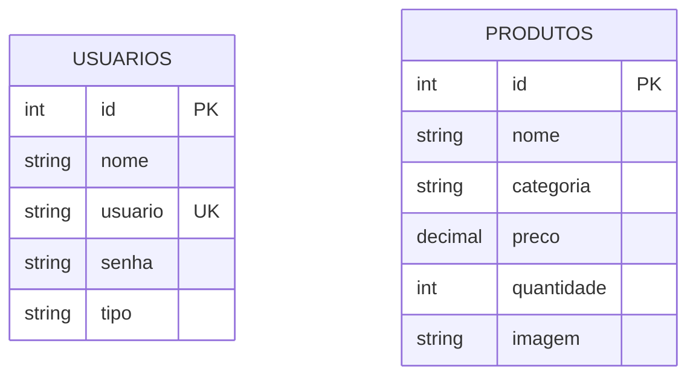

# Naruto Store - Gestão de Estoque

Projeto acadômico em PHP e PostgreSQL para controle de estoque de uma loja temática do universo de Naruto. Feito para praticar rotinas de CRUD, controle de acesso com sessão e modelagem de banco de dados relacional.

---

## Link de Acesso e Credenciais
- **URL da Aplicação (Rede Local):** `http://192.168.10.57/projeto_integrador`
- **Login do Administrador:** `naruto@viladafolha.com`
- **Senha do Administrador:** `123456`

---

## Protótipo no Figma
- **Link do Figma:** https://www.figma.com/design/lqtZDe0TALyaODf1Alrbr0/Prototipagem-Trabalho-Integrado?node-id=0-1&p=f&t=1iQ0mReWa8enld6O-0

---

## Tecnologias Usadas
- PHP 8 (puro, sem framework)
- PostgreSQL (conexão via PDO)
- HTML5 / CSS3 (layout Dark Mode)
- Apache / Linux (MobaXterm)

---

## O que o sistema faz
- **Login e Usuários:** Tela de login, cadastro de contas, controle de sessão (`$_SESSION`) e logout (`login/`).
- **Segurança:** Trava de acesso nas páginas internas (`verifica_user.php`) e consultas com Prepared Statements contra SQL Injection.
- **Inicialização e Setup:** Script automatizado (`setup.php`) para preparação inicial do ambiente.
- **CRUD de Produtos:**
  - `app/select.php` - Listagem geral do estoque.
  - `app/update.php` - Edição dos dados do produto.
  - `app/delete.php` - Exclusão de produtos (exclusivo para perfil admin).

---

## Implantação e Execução (Servidor Linux / Deploy Local)

O sistema roda sob o servidor web Apache e banco de dados PostgreSQL.

### 1. Clonar e Posicionar o Projeto
No diretório padrão de hospedagem do Apache (`/var/www/html/`):

```bash
cd /var/www/html/
git clone [https://github.com/SEU_USUARIO/projeto_integrador.git](https://github.com/SEU_USUARIO/projeto_integrador.git)
cd projeto_integrador
```

---

## Banco de Dados (`postgres.SQL`)

### 1. Como Criar e Importar a Estrutura no PostgreSQL
Para criar a base de dados `escola`, carregar a estrutura limpa das tabelas e o usuário administrador inicial:

```bash
# Criar o banco de dados 'escola' (caso ainda não exista)
sudo -u postgres createdb escola

# Importar o script de tabelas e dados iniciais
sudo -u postgres psql -d escola -f postgres.SQL
```

### 2. Configuração de Conexão (`database/connect.php`)
Certifique-se de que o arquivo `database/connect.php` possui as credenciais de acesso corretas do seu PostgreSQL local:

```php
$host = '192.168.10.57'; // IP do servidor PostgreSQL
$db   = 'escola';        // Nome da base de dados
$user = 'postgres';      // Utilizador do Postgres
$pass = 'turma1';        // Palavra-passe do utilizador
$port = '5432';
```

### 3. Como Visualizar as Tabelas no Terminal (Demonstração)
Para consultar as tabelas diretamente na CLI do PostgreSQL:

```bash
# 1. Entrar na CLI do PostgreSQL no banco escola
sudo -u postgres psql -d escola

# 2. Desativar a paginação (evita que a tabela quebre na tela)
\pset pager off

# 3. Consultar usuários e produtos
SELECT id, nome, usuario, tipo FROM usuarios;
SELECT id, nome, categoria, preco, quantidade FROM produtos;

# 4. Sair da CLI
\q
```

---

## Script SQL da Base de Dados (`postgres.SQL`)

```sql
-- 1. Limpa tabelas antigas para evitar erros
DROP TABLE IF EXISTS usuarios CASCADE;
DROP TABLE IF EXISTS produtos CASCADE;

-- 2. Tabela de usuarios
CREATE TABLE usuarios (
    id SERIAL PRIMARY KEY,
    nome VARCHAR(100) NOT NULL,
    usuario VARCHAR(50) UNIQUE NOT NULL,
    senha VARCHAR(255) NOT NULL,
    tipo VARCHAR(20) DEFAULT 'usuario'
);

-- 3. Tabela de produtos (vazia, pronta para cadastrar pelo site)
CREATE TABLE produtos (
    id SERIAL PRIMARY KEY,
    nome VARCHAR(150) NOT NULL,
    categoria VARCHAR(100),
    preco NUMERIC(10, 2) NOT NULL,
    quantidade INT DEFAULT 0,
    imagem TEXT
);

-- 4. Administrador para fazer login
INSERT INTO usuarios (nome, usuario, senha, tipo)
VALUES ('Naruto Uzumaki', 'naruto@viladafolha.com', '123456', 'admin');
```

---

## Estrutura de Arquivos

```text
projeto_integrador/
├── app/
│   ├── delete.php        # Exclusão de produtos
│   ├── select.php        # Listagem do estoque
│   └── update.php        # Edição de produtos
├── css/
│   └── style.css         # Estilos da aplicação
├── database/
│   └── connect.php       # Conexão PDO com PostgreSQL
├── includes/
│   ├── footer.php        # Rodapé
│   ├── functions.php     # Funções auxiliares do CRUD
│   └── header.php        # Topo e menu de navegação
├── login/
│   ├── cadastrar.php     # Registro de usuários
│   ├── login.php         # Autenticação
│   ├── logout.php        # Encerramento de sessão
│   └── verifica_user.php # Verificação de segurança
├── index.php             # Tela inicial da aplicação
├── postgres.SQL          # Script SQL do banco de dados
├── README.md             # Documentação oficial
└── setup.php             # Script de configuração inicial
```

---

## Dicionário de Dados

### Tabela: `usuarios`

| Coluna | Tipo | Restrições | Descrição |
| :--- | :--- | :--- | :--- |
| `id` | `SERIAL` | `PRIMARY KEY` | ID único do usuário |
| `nome` | `VARCHAR(100)` | `NOT NULL` | Nome completo |
| `usuario` | `VARCHAR(50)` | `UNIQUE`, `NOT NULL` | E-mail / Login de acesso |
| `senha` | `VARCHAR(255)` | `NOT NULL` | Senha de acesso |
| `tipo` | `VARCHAR(20)` | `DEFAULT 'usuario'` | Perfil (`admin` ou `usuario`) |

### Tabela: `produtos`

| Coluna | Tipo | Restrições | Descrição |
| :--- | :--- | :--- | :--- |
| `id` | `SERIAL` | `PRIMARY KEY` | ID único do produto |
| `nome` | `VARCHAR(150)` | `NOT NULL` | Nome do produto |
| `categoria` | `VARCHAR(100)` | - | Categoria do item |
| `preco` | `NUMERIC(10, 2)` | `NOT NULL` | Preço em R$ |
| `quantidade` | `INTEGER` | `DEFAULT 0` | Quantidade em estoque |
| `imagem` | `TEXT` | - | URL da imagem do produto |

---

## Diagrama de Entidade-Relacionamento (D.E.R.)



---

## Normalização do Banco de Dados

### Primeira Forma Normal (1FN)
- **Atributos Atômicos:** Cada coluna guarda apenas um valor por registro (ex: preço único, sem salvar múltiplos e-mails no mesmo campo).
- **Sem Grupos Repetidos:** Não existem colunas duplicadas.

### Segunda Forma Normal (2FN)
- **Atendimento à 1FN:** A estrutura cumpre todas as regras da 1FN.
- **Dependência Funcional Total:** Todos os campos não-chave dependem exclusivamente da chave primária (`id`).

### Terceira Forma Normal (3FN)
- **Atendimento à 2FN:** A estrutura cumpre todas as regras da 2FN.
- **Livre de Dependências Transitivas:** Não existem colunas não-chave que dependem de outras colunas não-chave.

---

## Autor
- Desenvolvido por **Lucas Galdino** para o Projeto Integrador.
