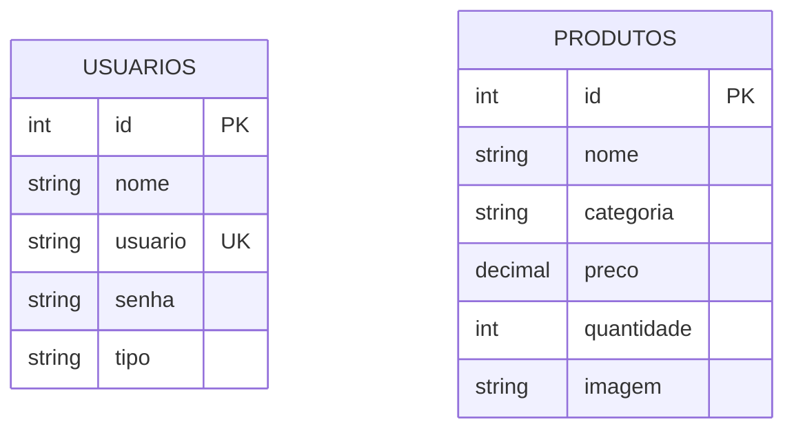

# Naruto Store - Gestão de Estoque

Projeto acadêmico em PHP e PostgreSQL para controle de estoque de uma loja temática do universo de Naruto. Feito para praticar rotinas de CRUD, controle de acesso com sessão e modelagem de banco de dados relacional.

---

## Protótipo no Figma
- Link do Figma: [https://www.figma.com/design/lqtZDe0TALyaODf1Alrbr0/Prototipagem-Trabalho-Integrado?node-id=0-1&p=f&t=1iQ0mReWa8enld6O-0](https://www.figma.com/design/lqtZDe0TALyaODf1Alrbr0/Prototipagem-Trabalho-Integrado?node-id=0-1&p=f&t=1iQ0mReWa8enld6O-0)

---

## Tecnologias Usadas
- PHP 8 (puro, sem framework)
- PostgreSQL (conexão via PDO)
- HTML5 / CSS3 (layout Dark Mode)
- Apache / Linux

---

## O que o sistema faz
- **Login e Usuários:** Tela de login, cadastro de contas, controle de sessão (`$_SESSION`) e logout.
- **Segurança:** Senhas salvas com hash (`password_hash`), trava de acesso nas páginas internas (`verifica_user.php`) e consultas com Prepared Statements contra SQL Injection.
- **CRUD de Produtos:**
  - `create.php` - Cadastra novos produtos (nome, categoria, preço, quantidade e imagem).
  - `select.php` - Tabela de listagem geral do estoque.
  - `select_w.php` - Busca rápida de um item por ID.
  - `update.php` - Edita os dados do produto.
  - `delete.php` - Exclui produtos (exclusivo para perfil admin).

---

## Estrutura de Arquivos

```text
projeto_integrador/
├── app/
│   ├── create.php       # Cadastro de produtos
│   ├── delete.php       # Exclusão de produtos
│   ├── select.php       # Listagem do estoque
│   ├── select_w.php     # Consulta por ID
│   └── update.php       # Edição de produtos
├── css/
│   └── style.css        # Estilos da aplicação
├── database/
│   └── connect.php      # Conexão PDO com PostgreSQL
├── includes/
│   ├── footer.php       # Rodapé
│   ├── functions.php    # Funções do CRUD
│   └── header.php       # Topo e menu
├── login/
│   ├── cadastrar.php    # Registro de usuário
│   ├── login.php        # Autenticação
│   ├── logout.php       # Encerramento de sessão
│   └── verifica_user.php# Trava de segurança das páginas
├── index.php            # Redirecionamento
├── postgres.SQL         # Script de criação do banco
└── README.md            # Documentação
```

---

## Dicionário de Dados

### Tabela: `usuarios`

| Coluna | Tipo | Restrições | Descrição |
| :--- | :--- | :--- | :--- |
| `id` | `SERIAL` | `PRIMARY KEY` | ID único do usuário |
| `nome` | `VARCHAR(100)` | `NOT NULL` | Nome completo |
| `usuario` | `VARCHAR(50)` | `UNIQUE`, `NOT NULL` | E-mail / Login de acesso |
| `senha` | `VARCHAR(255)` | `NOT NULL` | Senha criptografada |
| `tipo` | `VARCHAR(20)` | `DEFAULT 'usuario'` | Perfil (`admin` ou `usuario`) |

### Tabela: `produtos`

| Coluna | Tipo | Restrições | Descrição |
| :--- | :--- | :--- | :--- |
| `id` | `SERIAL` | `PRIMARY KEY` | ID único do produto |
| `nome` | `VARCHAR(150)` | `NOT NULL` | Nome do produto |
| `categoria` | `VARCHAR(100)` | - | Categoria do item |
| `preco` | `NUMERIC(10, 2)` | `NOT NULL` | Preço em R$ |
| `quantidade` | `INTEGER` | `DEFAULT 0` | Quantidade em estoque |
| `imagem` | `TEXT` | - | URL da foto do produto |

---

## Diagrama de Entidade-Relacionamento (D.E.R.)



---

## Normalização do Banco de Dados

### Primeira Forma Normal (1FN)
- **Atributos Atômicos:** Cada coluna guarda apenas um valor por registro (ex: preço único, sem salvar múltiplos e-mails no mesmo campo).

### Segunda Forma Normal (2FN)
- **Atendimento à 1FN:** A estrutura cumpre todas as regras da 1FN.
- **Dependência Funcional Total:** Todos os campos que não são chaves dependem exclusivamente do `id` da própria tabela.
