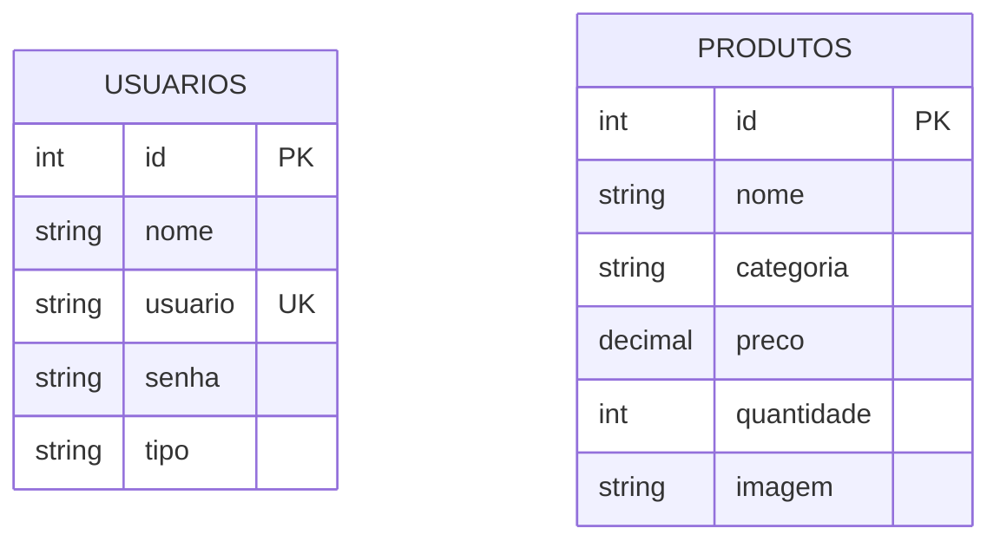

# Naruto Store - Gestão de Estoque

Projeto acadômico em PHP e PostgreSQL para controle de estoque de uma loja temática do universo de Naruto. Feito para praticar rotinas de CRUD, controle de acesso com sessão e modelagem de banco de dados relacional.

---

## Link de Acesso ao Sistema
- **URL da Aplicação:** `http://192.168.10.57/projeto_integrador`

---

## Protótipo no Figma
- Link do Figma: https://www.figma.com/design/lqtZDe0TALyaODf1Alrbr0/Prototipagem-Trabalho-Integrado?node-id=0-1&p=f&t=1iQ0mReWa8enld6O-0

---

## Tecnologias Usadas
- PHP 8 (puro, sem framework)
- PostgreSQL (conexão via PDO)
- HTML5 / CSS3 (layout Dark Mode)
- Apache / Linux (MobaXterm)

---

## O que o sistema faz
- **Login e Usuários:** Tela de login, cadastro de contas, controle de sessão (`$_SESSION`) e logout.
- **Segurança:** Senhas salvas com hash (`password_hash`), trava de acesso nas páginas internas (`verifica_user.php`) e consultas com Prepared Statements contra SQL Injection.
- **CRUD de Produtos:**
  - `create.php` - Cadastra novos produtos (nome, categoria, preço, quantidade e imagem).
  - `select.php` - Tabela de listagem geral do estoque.
  - `select_w.php` - Busca rápida de um item por ID.
  - `update.php` - Edita os dados do produto.
  - `delete.php` - Exclui produtos (exclusivo para perfil admin).

---

## Implantação e Execução (Servidor Linux)

O sistema roda no servidor local Linux sob o servidor web Apache.

### 1. Localização do Projeto
O projeto está localizado no diretório padrão do Apache:
```bash
cd /var/www/html/projeto_integrador
```

### 2. Sincronização com o GitHub
A manutenção e o deploy do código são feitos diretamente pelo terminal via SSH (MobaXterm):
```bash
git add .
git commit -m "Ajustes"
git push origin main
```

---

## Banco de Dados (`postgres.SQL`)

### Como Importar o Banco no PostgreSQL
Para carregar a estrutura das tabelas e os dados iniciais no banco `escola`:

```bash
sudo -u postgres psql -d escola -f postgres.SQL
```

*Ou acesse o terminal do banco:*
```bash
sudo -u postgres psql -d escola
```

---

## Script SQL da Base de Dados (`postgres.SQL`)

```sql
-- Conectar ao banco de dados 'escola'
-- \c escola;

-- 1. Tabela de Usuários
CREATE TABLE IF NOT EXISTS usuarios (
    id SERIAL PRIMARY KEY,
    nome VARCHAR(100) NOT NULL,
    usuario VARCHAR(50) UNIQUE NOT NULL,
    senha VARCHAR(255) NOT NULL,
    tipo VARCHAR(20) DEFAULT 'usuario'
);

-- 2. Tabela de Produtos
CREATE TABLE IF NOT EXISTS produtos (
    id SERIAL PRIMARY KEY,
    nome VARCHAR(150) NOT NULL,
    categoria VARCHAR(100),
    preco NUMERIC(10, 2) NOT NULL,
    quantidade INTEGER DEFAULT 0,
    imagem TEXT
);

-- Inserção de Usuário Administrador Padrão
-- Login: naruto@viladafolha.com | Senha: 123456
INSERT INTO usuarios (nome, usuario, senha, tipo)
VALUES (
    'Naruto Uzumaki',
    'naruto@viladafolha.com',
    '$2y$10$e0MYzXyjpJS7Pd0RVvHwHe8fS.g4u8L5aE5yq0IeQd21yvB5k3mK6',
    'admin'
) ON CONFLICT (usuario) DO NOTHING;

-- Inserção de Produtos Exemplo
INSERT INTO produtos (nome, categoria, preco, quantidade, imagem) VALUES
('Kunai Minato Namikaze', 'Armas', 45.90, 10, '[https://m.media-amazon.com/images/I/61xtL.jpg](https://m.media-amazon.com/images/I/61xtL.jpg)'),
('Manto da Akatsuki', 'Acessórios', 30.00, 2, '[https://soi-bucket.s3.amazonaws.com/manto.jpg](https://soi-bucket.s3.amazonaws.com/manto.jpg)'),
('Crocs Sasuke Uchiha', 'Colecionável', 199.90, 0, '[https://droper-media.s3.amazonaws.com/sasuke.jpg](https://droper-media.s3.amazonaws.com/sasuke.jpg)');
```

---

## Estrutura de Arquivos

```text
projeto_integrador/
├── app/
│   ├── create.php        # Cadastro de produtos
│   ├── delete.php        # Exclusão de produtos
│   ├── select.php        # Listagem do estoque
│   ├── select_w.php      # Consulta por ID
│   └── update.php        # Edição de produtos
├── css/
│   └── style.css         # Estilos da aplicação
├── database/
│   └── connect.php       # Conexão PDO com PostgreSQL
├── includes/
│   ├── footer.php        # Rodapé
│   ├── functions.php     # Funções do CRUD
│   └── header.php        # Topo e menu
├── login/
│   ├── cadastrar.php     # Registro de usuário
│   ├── login.php         # Autenticação
│   ├── logout.php        # Encerramento de sessão
│   └── verifica_user.php # Trava de segurança das páginas
├── index.php             # Redirecionamento e tela inicial
├── postgres.SQL          # Script SQL do banco de dados
└── README.md             # Documentação oficial
```

---

## Dicionário de Dados

### Tabela: `usuarios`

| Coluna | Tipo | Restrições | Descrição |
| :--- | :--- | :--- | :--- |
| `id` | `SERIAL` | `PRIMARY KEY` | ID único do usuário |
| `nome` | `VARCHAR(100)` | `NOT NULL` | Nome completo |
| `usuario` | `VARCHAR(50)` | `UNIQUE`, `NOT NULL` | E-mail / Login de acesso |
| `senha` | `VARCHAR(255)` | `NOT NULL` | Senha criptografada |
| `tipo` | `VARCHAR(20)` | `DEFAULT 'usuario'` | Perfil (`admin` ou `usuario`) |

### Tabela: `produtos`

| Coluna | Tipo | Restrições | Descrição |
| :--- | :--- | :--- | :--- |
| `id` | `SERIAL` | `PRIMARY KEY` | ID único do produto |
| `nome` | `VARCHAR(150)` | `NOT NULL` | Nome do produto |
| `categoria` | `VARCHAR(100)` | - | Categoria do item |
| `preco` | `NUMERIC(10, 2)` | `NOT NULL` | Preço em R$ |
| `quantidade` | `INTEGER` | `DEFAULT 0` | Quantidade em estoque |
| `imagem` | `TEXT` | - | URL da foto do produto |

---

## Diagrama de Entidade-Relacionamento (D.E.R.)



---

## Normalização do Banco de Dados

### Primeira Forma Normal (1FN)
- **Atributos Atômicos:** Cada coluna guarda apenas um valor por registro (ex: preço único, sem salvar múltiplos e-mails no mesmo campo).
- **Sem Grupos Repetidos:** Não existem colunas duplicadas.

### Segunda Forma Normal (2FN)
- **Atendimento à 1FN:** A estrutura cumpre todas as regras da 1FN.
- **Dependência Funcional Total:** Todos os campos que não são chaves dependem exclusivamente do `id` da própria tabela.
