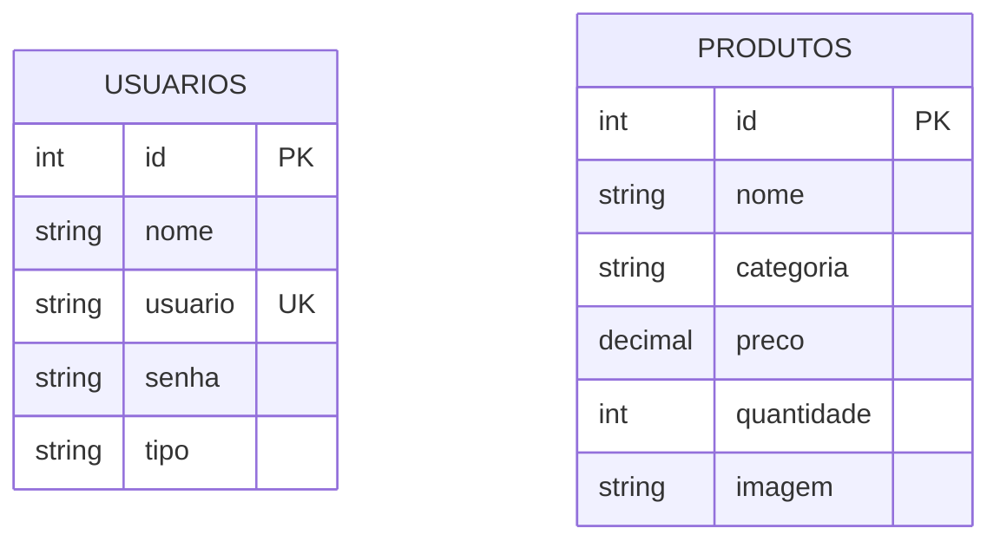

│   └── connect.php       # Conexão PDO com PostgreSQL
├── includes/
│   ├── footer.php        # Rodapé
│   ├── functions.php     # Funções auxiliares do CRUD
│   └── header.php        # Topo e menu de navegação
├── login/
│   ├── cadastrar.php     # Registro de usuários
│   ├── login.php         # Autenticação
│   ├── logout.php        # Encerramento de sessão
│   └── verifica_user.php # Verificação de segurança
├── index.php             # Tela inicial da aplicação
├── postgres.SQL          # Script SQL do banco de dados
├── README.md             # Documentação oficial
└── setup.php             # Script de configuração inicial
```

---

## Dicionário de Dados

### Tabela: `usuarios`

| Coluna | Tipo | Restrições | Descrição |
| :--- | :--- | :--- | :--- |
| `id` | `SERIAL` | `PRIMARY KEY` | ID único do usuário |
| `nome` | `VARCHAR(100)` | `NOT NULL` | Nome completo |
| `usuario` | `VARCHAR(50)` | `UNIQUE`, `NOT NULL` | E-mail / Login de acesso |
| `senha` | `VARCHAR(255)` | `NOT NULL` | Senha criptografada |
| `tipo` | `VARCHAR(20)` | `DEFAULT 'usuario'` | Perfil (`admin` ou `usuario`) |

### Tabela: `produtos`

| Coluna | Tipo | Restrições | Descrição |
| :--- | :--- | :--- | :--- |
| `id` | `SERIAL` | `PRIMARY KEY` | ID único do produto |
| `nome` | `VARCHAR(150)` | `NOT NULL` | Nome do produto |
| `categoria` | `VARCHAR(100)` | - | Categoria do item |
| `preco` | `NUMERIC(10, 2)` | `NOT NULL` | Preço em R$ |
| `quantidade` | `INTEGER` | `DEFAULT 0` | Quantidade em estoque |
| `imagem` | `TEXT` | - | URL da imagem do produto |

---

## Diagrama de Entidade-Relacionamento (D.E.R.)



---

## Normalização do Banco de Dados

### Primeira Forma Normal (1FN)
- **Atributos Atômicos:** Cada coluna guarda apenas um valor por registro (ex: preço único, sem guardar múltiplos e-mails no mesmo campo).
- **Sem Grupos Repetidos:** Não existem colunas duplicadas.

### Segunda Forma Normal (2FN)
- **Atendimento à 1FN:** A estrutura cumpre todas as regras da 1FN.
- **Dependência Funcional Total:** Todos os campos que não são chaves dependem exclusivamente do `id` da própria tabela.
